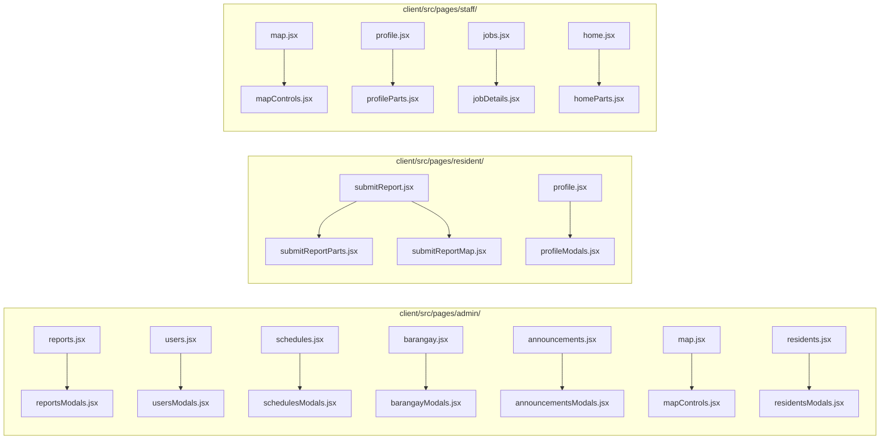

# Audit Report: Valencia-PowerWatch

Generated: 2026-11-09

## Executive Summary

Valencia-PowerWatch is a React 19 + Vite 8 SPA (`client/`) backed by 13 modular PostgreSQL schema/seed files (`supabase/`). While directory nesting (`≤ 3` levels from `client/src/`) and folder file counts (`≤ 17` files per folder) are well within healthy bounds, **11 orphaned image/SVG artifacts** clutter `client/src/assets/`, `client/src/common/pagination.jsx` sits in an isolated single-file top-level folder outside `components/`, and **13 page components exceed the 400-line threshold** (led by `admin/reports.jsx` at 1,344 lines and `resident/submitReport.jsx` at 1,110 lines).

## Severity Legend

- 🔴 **Blocker / Warning** — exceeds structural threshold and should be fixed
- 🟡 **Warning** — moderate structural smell
- 🟢 **Suggestion** — convention or organization improvement

---

## Audit Metrics Overview

| # | Metric | Threshold | Measured Max | Status |
|---|---|---|---|---|
| 1 | **Folder file count** | `> 30` files/dir | `17` (`client/src/pages/admin/`) | ✅ Pass |
| 2 | **File line count** | `> 400` lines/file | `1,344` (`admin/reports.jsx`) | 🔴 13 files exceed |
| 3 | **Nesting depth** | `> 4` levels from `src/` | `3` (`pages/auth/resident-staff/`) | ✅ Pass |
| 4 | **Naming conventions** | Consistent per folder | Mixed in `assets/` & `hooks/` | 🟢 Suggestion |
| 5 | **Orphaned / misplaced files** | 0 unused / misplaced | 11 unused assets + `common/pagination.jsx` | 🔴 Warning |
| 6 | **Doc sprawl** | `> 5` scattered `.md` | `4` `.md` files | ✅ Pass |
| 7 | **Empty / dead directories** | 0 empty dirs | `0` empty dirs | ✅ Pass |

---

## Issues Found

### Phase 1: Quick Cleanup

_Low effort, safe changes. No application logic is altered._

- [x] **Remove 11 orphaned/unused asset files in `client/src/assets/`** — Only `logo.png`, `electricity.png`, and `valencia-city-panorama.jpg` are imported anywhere in `client/`. The remaining 11 files (`1.png`, `electricity_original.png`, `hero.png`, `image.png`, `image copy.png`, `image copy 2.png`, `image copy 3.png`, `image copy 4.png`, `logo.jpg`, `react.svg`, `vite.svg`) are unreferenced bloat with spaces/copy suffixes in their names.

  **Before:**
  ```text
  client/src/assets/
  ├── 1.png                        (unused)
  ├── electricity.png              (used)
  ├── electricity_original.png     (unused)
  ├── hero.png                     (unused)
  ├── image copy 2.png             (unused)
  ├── image copy 3.png             (unused)
  ├── image copy 4.png             (unused)
  ├── image copy.png               (unused)
  ├── image.png                    (unused)
  ├── logo.jpg                     (unused)
  ├── logo.png                     (used)
  ├── react.svg                    (unused)
  ├── valencia-city-panorama.jpg   (used)
  └── vite.svg                     (unused)
  ```

  **After:**
  ```text
  client/src/assets/
  ├── electricity.png
  ├── logo.png
  └── valencia-city-panorama.jpg
  ```

- [x] **Move misplaced single-file directory `client/src/common/pagination.jsx` into `client/src/components/common/pagination.jsx`** — Eliminates the isolated 1-file `src/common/` directory and groups shared UI components under `src/components/`.

  | Consumer File | Old Import | New Import |
  |---|---|---|
  | `client/src/pages/admin/residents.jsx` | `../../common/pagination` | `../../components/common/pagination` |
  | `client/src/pages/admin/users.jsx` | `../../common/pagination` | `../../components/common/pagination` |
  | `client/src/pages/admin/barangay.jsx` | `../../common/pagination` | `../../components/common/pagination` |

---

### Phase 2: File Refactoring (Splitting Oversized Files > 400 Lines)

_Medium effort — split oversized page files into cohesive `<page>Modals.jsx` / `<page>Parts.jsx` companion modules so every application file stays `≤ 400` lines._



- [x] **Split `client/src/pages/admin/reports.jsx`** — 1,344 lines → `reports.jsx` (`≤ 400` lines) + `reportsModals.jsx` (`ReportDetailsGrid`, `ReportEvidence`, `ReportLocationMap`, `ReportReviewDialog`).
- [x] **Split `client/src/pages/resident/submitReport.jsx`** — 1,110 lines → `submitReport.jsx` (`≤ 400` lines) + `submitReportMap.jsx` + `submitReportParts.jsx`.
- [x] **Split `client/src/pages/admin/users.jsx`** — 744 lines → move sub-components/table cells into `usersModals.jsx` / `usersParts.jsx` so both stay `≤ 400` lines.
- [x] **Split `client/src/pages/staff/map.jsx`** — 733 lines → extract map sub-components and routing drawer into `client/src/pages/staff/mapControls.jsx`.
- [x] **Split `client/src/pages/admin/schedules.jsx`** — 624 lines → extract `ScheduleBadge`, `EmptyScheduleState`, and create/edit/delete dialogs into `client/src/pages/admin/schedulesModals.jsx`.
- [x] **Split `client/src/pages/admin/barangay.jsx`** — 579 lines → extract KPI header cards and table row helpers so `barangay.jsx` stays `≤ 400` lines.
- [x] **Split `client/src/pages/staff/profile.jsx`** — 527 lines → extract password dialog and work-history/preferences sections into `client/src/pages/staff/profileParts.jsx`.
- [x] **Split `client/src/pages/staff/jobs.jsx`** — 515 lines → move job review modal into `client/src/pages/staff/jobDetails.jsx` so both stay `≤ 400` lines.
- [x] **Split `client/src/pages/staff/home.jsx`** — 511 lines → extract update modal & dashboard stat cards into `client/src/pages/staff/homeParts.jsx`.
- [x] **Split `client/src/pages/admin/announcements.jsx`** — 503 lines → extract create/edit/delete announcement dialogs into `client/src/pages/admin/announcementsModals.jsx`.
- [x] **Split `client/src/pages/admin/map.jsx`** — 477 lines → move report detail drawer/panel into `client/src/pages/admin/mapControls.jsx`.
- [x] **Split `client/src/pages/resident/profile.jsx`** — 468 lines → move notification toggles / account cards into `client/src/pages/resident/profileModals.jsx`.
- [x] **Split `client/src/pages/admin/residents.jsx`** — 411 lines → extract resident details modal into `client/src/pages/admin/residentsModals.jsx`.

---

### Phase 3: Structural Organization & Verification

_Ensure directory organization is clean and all builds/lints pass with zero warnings._

- [x] **Organize `client/src/pages/admin/`** — verify all page modules and companion modal files follow consistent naming and import paths without breaking `src/routes/routes.jsx`.
- [x] **Verify full ESLint + Vite production build** (`npm --prefix client run lint && npm --prefix client run build`).

---

## Refactoring Progress

**Phase 1:** `[x] completed`
**Phase 2:** `[x] completed`
**Phase 3:** `[x] completed`
